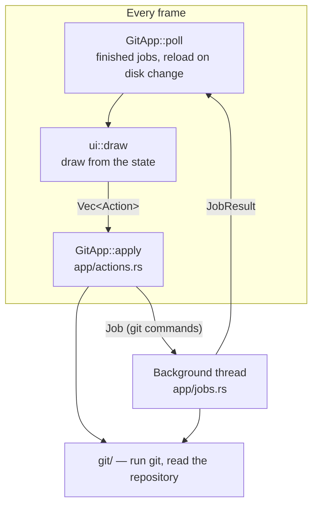
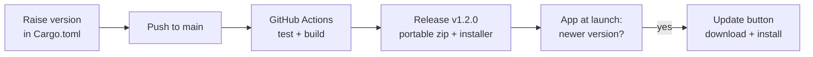

# Contributing to Git Simple GUI

Thanks for your interest! This page is for developers: how to build the app, how the code is
organized, and how releases are made. For using the app, see the [README](README.md).

- [Reporting a bug or an idea](#reporting-a-bug-or-an-idea)
- [Building from source](#building-from-source)
- [Architecture](#architecture)
- [Release process](#release-process)

## Reporting a bug or an idea

Open an [issue](https://github.com/pierreBocquillon/Git-Simple-GUI/issues) with what you did, what
you expected and what happened (a screenshot helps). Pull requests are reviewed by the maintainer;
please run `cargo fmt`, `cargo clippy` and `cargo test` first.

## Building from source

Requirements: [Rust](https://rustup.rs) (stable) and Git for Windows.

```powershell
git clone https://github.com/pierreBocquillon/git-simple-gui.git
cd git-simple-gui
cargo run --release
```

```powershell
cargo test          # unit tests (graph layout, repository reading, diffs, translations, URLs)
cargo clippy        # lints
cargo fmt           # formatting
```

To build the installer locally, install [Inno Setup 6](https://jrsoftware.org/isinfo.php), then:

```powershell
cargo build --release
& "${env:ProgramFiles(x86)}\Inno Setup 6\ISCC.exe" /DAppVersion=1.0.0 installer\setup.iss
```

## Architecture

The code is split into three layers: **`git/`** talks to Git and knows nothing about the screen,
**`app/`** holds the state and carries out requests, **`ui/`** draws everything.
The interface never runs Git itself: it only emits *actions*.



```
src/
├── main.rs              Entry point: creates the window and starts the app
├── graph.rs             Commit graph layout (which lane for each commit, which lines)
├── avatars.rs           Authors' GitHub profile pictures (downloaded in the background)
├── github.rs            Optional GitHub account (token in the Windows Credential Manager)
├── update.rs            Updates: latest GitHub release, download and run the installer
├── i18n/                Translations: mod.rs (tr! macro, languages) + en/fr/de/es.rs
│
├── git/                 Everything that talks to git (no UI code here)
│   ├── command.rs       Run the `git` executable
│   ├── model.rs         Data types: Commit, RefInfo, Status, Stash, Remote…
│   ├── repository.rs    Read a repository (commits, refs, status, commit details)
│   ├── diff.rs          File diffs and their parser
│   └── names.rs         Author initials, valid branch names
│
├── app/                 Application state
│   ├── mod.rs           GitApp: tabs, frame loop, automatic reload
│   ├── repo_tab.rs      One open repository (data, selection, undo history)
│   ├── actions.rs       Action: everything the UI can ask for, and how it is done
│   ├── jobs.rs          Job: git commands run in the background, and what follows
│   ├── commands.rs      Ready-made jobs (checkout, stage, unstage…)
│   ├── dialog.rs        The data typed into dialog windows
│   ├── settings.rs      What is remembered between launches
│   ├── updates.rs       Update check at launch, install
│   └── workspace.rs     Workspaces: groups of tabs, switching, moving tabs
│
└── ui/                  Everything drawn on screen
    ├── mod.rs           Assembles the window, keyboard shortcuts
    ├── theme.rs         Colors, fonts, widget style
    ├── paint.rs         Drawing helpers (gradients, glows, truncated text)
    ├── icons.rs         Vector icons
    ├── widgets.rs       Buttons, badges, file rows, headers, avatars
    ├── window_frame.rs  Custom title bar: minimize/maximize/close, move, resize
    ├── tab_bar.rs       Top bar: settings, workspace, tabs, update button
    ├── toolbar.rs       Toolbar (Undo, Pull, Push, Branch, Stash…)
    ├── sidebar.rs       Left panel (LOCAL, REMOTE, STASHES, TAGS)
    ├── graph/           Commit graph table (rows, edges, labels)
    ├── diff_view.rs     File diff view
    ├── details/         Right panel: WIP staging, commit details, stash contents
    ├── state_banner.rs  "Merge / rebase in progress" banner
    ├── status_bar.rs    Bottom status bar
    ├── welcome.rs       Welcome page (open, clone, create)
    ├── dialogs.rs       Dialog windows
    ├── menus.rs         Right-click menus
    └── toasts.rs        Notifications
```

### Adding a feature

Most features are a menu entry in `ui/menus.rs` that pushes a `Job` (a list of git commands run in
the background, with a label and what to do afterwards). If it needs input, add a variant to
`Dialog` (`app/dialog.rs`) and its form in `ui/dialogs.rs`.

### Adding or editing a translation

Every text on screen is a key: `tr!("toolbar.undo")`, or `tr!("action.pull_label", branch = name)`
to fill `{branch}`. Each language is one file in `src/i18n` (`en.rs`, `fr.rs`, `de.rs`, `es.rs`)
listing `(key, text)` pairs grouped by screen. To add a text, add its key to the four files;
`cargo test` checks that every language has the same keys and the same `{placeholders}`.
A new language is a new file plus one line in the `Lang` enum.

## Release process



- Every push to `main` runs [`release.yml`](.github/workflows/release.yml): tests and a release build.
- **To publish a version**, raise `version` in [`Cargo.toml`](Cargo.toml) (e.g. `1.1.0` → `1.2.0`)
  and push. The workflow sees that `v1.2.0` has no release yet and publishes one, tagged `v1.2.0`,
  with the portable zip and the installer ([`installer/setup.iss`](installer/setup.iss), Inno Setup).
  A push that keeps the same version only tests and builds.
- Released copies know their repository (`GITHUB_REPOSITORY`, set at build time). At launch they
  ask GitHub for the latest release and compare its version with their own; when it is newer, an
  **Update** button appears. A copy built locally never checks.
