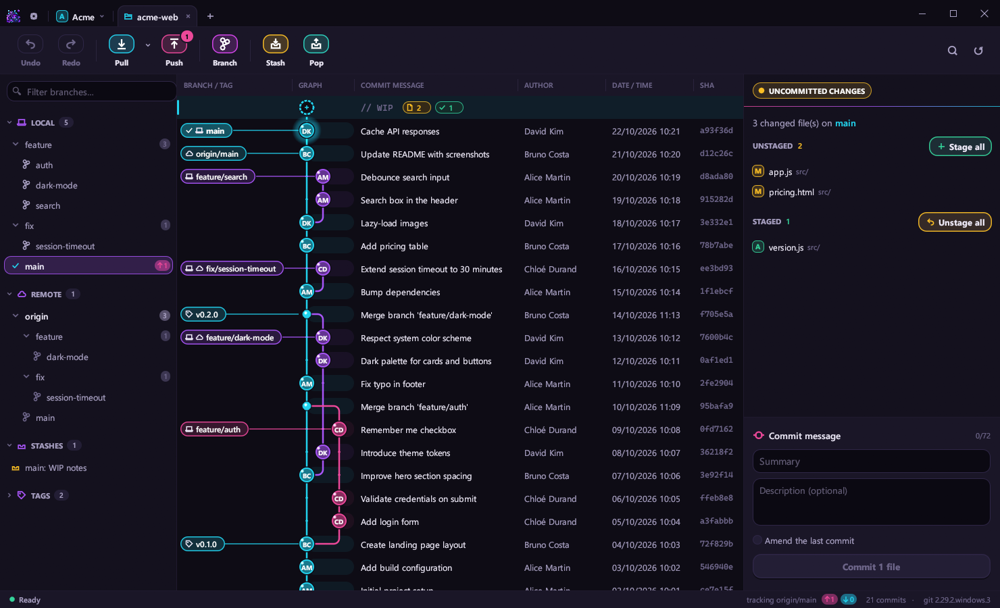
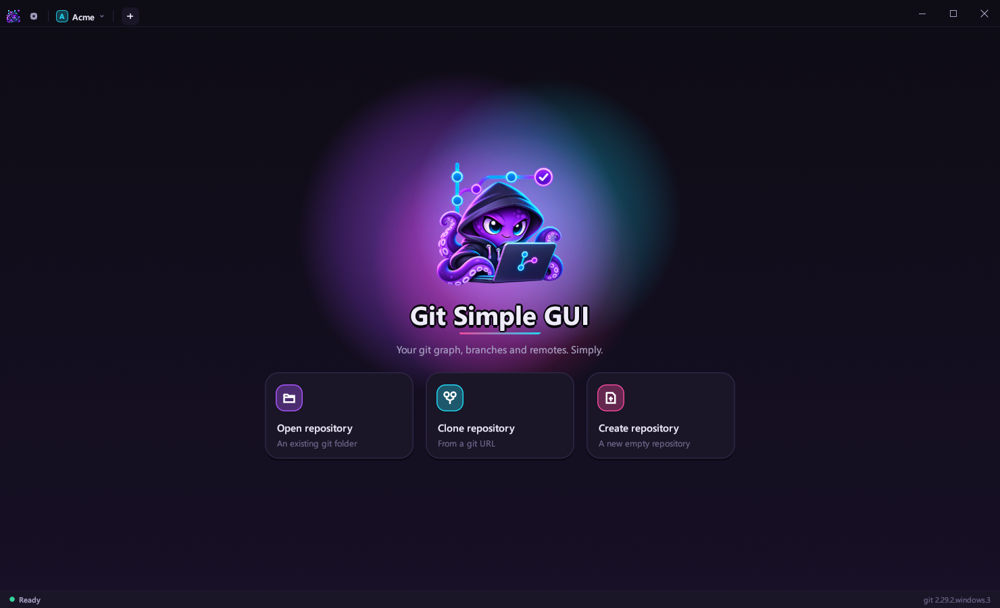
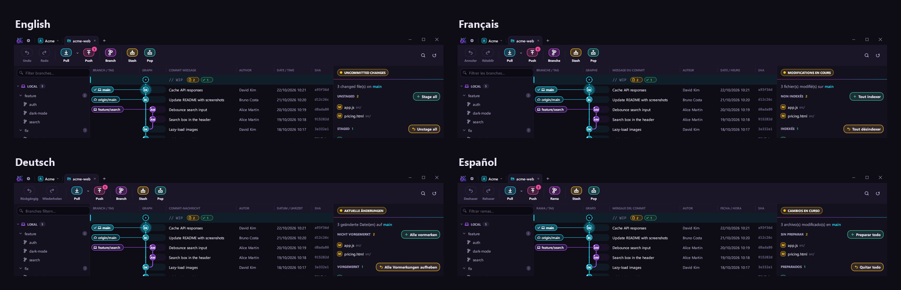

# Git Simple GUI

**A fast, dark Git client for Windows — your graph, branches and remotes. Simply.**

### [⬇ Download for Windows](https://github.com/pierreBocquillon/Git-Simple-GUI/releases/latest)

---

**Git Simple GUI** makes Git easy to follow and easy to use. Your project's history appears as a
clear, colorful graph, and the things you do every day — save your work, get your team's changes,
send yours, create a branch — are one click away.

No command line to remember, no account to create: install it, open your project, and go.

- 🎨 **See everything at a glance** — every branch on its own colored line, with who did what and when.
- 🖱️ **One click for everyday tasks** — commit, pull, push, branch, merge, stash.
- 🛟 **Safe** — risky actions ask first, and most actions can be undone with one click.
- 🗂️ **Organized** — group your projects into workspaces (*Work*, *Personal*…) and switch instantly.
- 🌍 **In your language** — English, Français, Deutsch, Español.
- 🔄 **Always up to date** — new versions install themselves in one click.

## Contents

- [Installation](#installation)
- [Getting started](#getting-started)
- [What you can do](#what-you-can-do)
- [Keyboard shortcuts](#keyboard-shortcuts)
- [Languages](#languages)
- [Profile pictures and GitHub account](#profile-pictures-and-github-account)
- [Updates](#updates)
- [Privacy](#privacy)
- [FAQ](#faq)
- [Uninstalling](#uninstalling)
- [Help and feedback](#help-and-feedback)

## Installation

**You need:** Windows 10 or 11, and [Git for Windows](https://git-scm.com/download/win)
(free — install it first if you don't have it).

1. Go to the [latest release](https://github.com/pierreBocquillon/Git-Simple-GUI/releases/latest).
2. Download **`GitSimpleGUI-Setup.exe`** and run it.
3. Choose your language, then follow the steps. No administrator rights are needed.

> [!NOTE]
> Windows may show *“Windows protected your PC”* the first time, because the app is new and not
> yet signed. Click **More info → Run anyway**. ([Why?](#windows-says-it-protected-my-pc))

<b>Prefer a portable version?</b>

Download **`GitSimpleGUI-portable.zip`**, unzip it anywhere (a USB key, a tools folder) and run
`git-simple-gui.exe`. Nothing is installed. Your settings are still kept in your Windows profile.

## Getting started

1. **Open your project.** On the welcome page, choose:
   - **Open repository** — a folder that already uses Git;
   - **Clone repository** — download a project from GitHub, GitLab… using its link;
   - **Create repository** — start a new project from an empty folder.
2. **Tell Git who you are** (first time only): click **⚙ → Git identity** and enter your name and
   email. They are written in each change you save.
3. **Save your work.** The **WIP** line at the top of the graph lists the files you changed. Click
   it, choose the files to include, write a short message and click **Commit**.
4. **Share it.** Click **Push** to send your commits, **Pull** to get the others' changes.

Right-click on anything — a branch, a commit, a tag — to see everything you can do with it.

## What you can do

### Follow your project's history
- See the whole history as a graph: branches, merges and tags at a glance.
- Click any commit to see what changed, file by file.
- Search by message, author or commit ID with <kbd>Ctrl</kbd>+<kbd>F</kbd>.
- Each person's picture next to their commits (or their initials).

### Save and share your work
- Pick which files go into a commit, or take them all.
- Undo the changes to a file you don't want to keep.
- Fix the last commit (forgot a file, typo in the message).
- Pull and push with one click; the buttons show how many commits are waiting.

### Work with branches
- Create, rename, switch to and delete branches.
- Merge a branch into another, or rebase it.
- Copy a single commit to another branch (*cherry-pick*), or undo a commit (*revert*).
- Put your current changes aside for later (*stash*) and bring them back (*pop*).
- Tags, and remotes (add, edit, remove) are in the left panel.

### Stay safe
- **Undo / Redo** buttons for commits, branch switches, deletions and resets.
- A confirmation before anything that rewrites history or affects the server.
- When Git hits a problem (missing name, conflicts, refused password…), the app explains it in
  plain words and tells you what to do.
- If a merge stops on conflicts, a banner tells you. For each file, keep your version or theirs
  (in the **WIP** panel), then click **Continue** — or **Abort** to go back as before.

### Stay organized
- Every project opens in a **tab**.
- Group tabs into **workspaces** — for example *Work* and *Personal* — and only see the current
  one's tabs. Switch with the menu at the top left or with <kbd>Ctrl</kbd>+<kbd>1</kbd>…<kbd>9</kbd>.
- Right-click a tab to move it to another workspace.
- Projects refresh by themselves when they change on disk.

## Keyboard shortcuts

| Shortcut | Action |
| --- | --- |
| <kbd>Ctrl</kbd>+<kbd>O</kbd> | Open a repository |
| <kbd>F5</kbd> | Refresh |
| <kbd>Ctrl</kbd>+<kbd>F</kbd> | Search commits (<kbd>Enter</kbd>: next result) |
| <kbd>↑</kbd> / <kbd>↓</kbd> | Move through the commits |
| <kbd>Ctrl</kbd>+<kbd>Enter</kbd> | Commit (while writing the message) |
| <kbd>Esc</kbd> | Close the file view |
| <kbd>Ctrl</kbd>+<kbd>1</kbd> … <kbd>Ctrl</kbd>+<kbd>9</kbd> | Switch workspace |
| Middle click on a tab | Close the tab |
| Double click on the top bar | Maximize / restore the window |

## Languages

Git Simple GUI speaks **English**, **Français**, **Deutsch** and **Español**. The installer asks
for your language; you can change it any time in **⚙ → Language**.

Git's own words (*Pull*, *Push*, *Commit*, *Merge*…) stay in English in every language, like in
most Git tools, so what you read online always matches what you see.

## Profile pictures and GitHub account

Next to each commit, the app shows the author's **GitHub profile picture** when it can find it,
and their initials otherwise. This works by itself for **public** projects hosted on GitHub.

For **private** projects, connect your GitHub account: **⚙ → Connect a GitHub account…**, click
**Create a token on GitHub**, tick **repo**, click *Generate token*, then paste the token in the app.
It is stored safely by Windows (Credential Manager), never in a file, and only used to find
profile pictures and check for updates. You can disconnect at any time from the same menu.

## Updates

When a new version is available, an **Update** button appears at the top right of the window.
Click it: the new version downloads, installs, and the app reopens — that's it.
You can also check yourself with **⚙ → Check for updates**.

## Privacy

Git Simple GUI does not collect anything: no account, no tracking, no statistics. It only connects to:

- **your Git servers** (GitHub, GitLab…), when you pull, push or clone — exactly like Git does;
- **GitHub**, to find profile pictures (projects hosted on GitHub only) and to check for updates.

Your email address is never sent anywhere.

## FAQ

<b>The app says Git is not installed.</b>

Git Simple GUI uses the Git installed on your computer. Install
[Git for Windows](https://git-scm.com/download/win) (default options are fine), then restart the app.

<b>Windows says it protected my PC.</b>

Windows SmartScreen warns about any new program that is not yet signed with a certificate. The app
is open source and built publicly from its code on GitHub. Click **More info → Run anyway**. Updates
installed from inside the app do not show this warning.

<b>Pull or push asks for a password, or is refused.</b>

The app uses the same login as Git on your computer. The first time, a Git Credential Manager window
may ask you to sign in to GitHub/GitLab: do it once and it is remembered. With SSH links
(`git@github.com:…`), make sure your SSH key is set up for Git.

<b>I made a mistake. How do I go back?</b>

Click **Undo** in the toolbar: it reverses the last commit, branch switch, deletion or reset.
**Redo** brings it back.

<b>Do I lose anything if I close a tab or delete a workspace?</b>

No. Tabs and workspaces are only how the app shows your projects; your files and their Git history
on disk are never touched.

<b>Can I open a folder directly?</b>

Yes: drop a folder path on the command line — `git-simple-gui.exe C:\Projects\my-project` — or use
**Open repository** (<kbd>Ctrl</kbd>+<kbd>O</kbd>).

## Uninstalling

Open **Windows Settings → Apps**, find **Git Simple GUI** and click **Uninstall**. Your projects
are not affected. To also remove your settings, delete `%APPDATA%\GitSimpleGUI` and
`%LOCALAPPDATA%\GitSimpleGUI`.

## Help and feedback

Found a bug or have an idea? Open an [issue](https://github.com/pierreBocquillon/Git-Simple-GUI/issues).
Developers: see [CONTRIBUTING.md](CONTRIBUTING.md) to build the app and find your way around the code.

## License

Git Simple GUI is free and open-source software under the
[GNU General Public License v3.0 or later](LICENSE).
Copyright (C) 2026 Pierre Bocquillon — https://github.com/pierreBocquillon/Git-Simple-GUI
